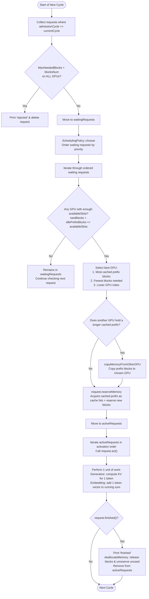
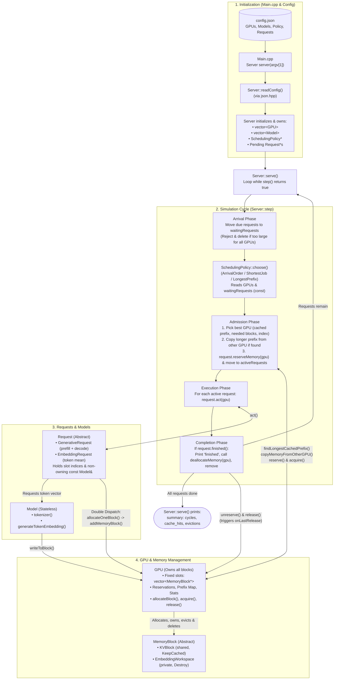

### 1. Request Lifecycle & Server Flow (`Server::step`)



---

### 2. Prefix Caching Mechanism (Lookup, Filling & Release)

```mermaid
flowchart TD
    subgraph Lookup ["1. Prefix Lookup (GPU::findLongestCachedPrefix)"]
        L1["Receive promptTokens & modelId"] --> L2["Divide into full blocks of t = blockSize / embeddingSize tokens"]
        L2 --> L3{"Cached block exists on GPU for<br/>modelId + first k*t tokens?"}
        L3 -- Yes --> L4["Add slot to match list<br/>Check next block k+1"]
        L4 --> L3
        L3 -- No --> L5["Stop at first missing block<br/>Return matched slots & h covered tokens"]
    end

    subgraph Fill ["2. Filling Blocks during act()"]
        F1["Write token KV vector to block<br/>Block has no key while filling"] --> F2{"Is block full?<br/>t tokens written"}
        F2 -- No --> F3["Block remains without a key"]
        F2 -- Yes --> F4["Call GPU::assignPrefixToBlock"]
        F4 --> F5{"Another block already has<br/>same modelId & prefixKey?"}
        F5 -- Yes --> F6["Not cached<br/>Remains without a key"]
        F5 -- No --> F7["Store modelId & prefixKey for this slot"]
    end

    subgraph Release ["3. Releasing a Block (GPU::release)"]
        R1["refCount--"] --> R2{"refCount == 0?"}
        R2 -- No --> R3["Block stays Active<br/>Still held by other requests"]
        R2 -- Yes --> R4{"Check onLastRelease()"}
        R4 -->|"EmbeddingWorkspace<br/>(Destroy)"| R5["Delete block<br/>Slot becomes nullptr"]
        R4 -->|"KVBlock<br/>(KeepCached)"| R6{"Does block have<br/>a prefixKey?"}
        R6 -->|"No (partial or duplicate)"| R7["Delete block & empty slot<br/>Not counted as eviction"]
        R6 -- Yes --> R8["Block becomes Idle<br/>Available for reuse or eviction"]
    end
```



### 3. General Program Workflow & Components


````[cite: 1, 6, 7, 8, 9, 10, 11, 12, 13, 14, 15]
